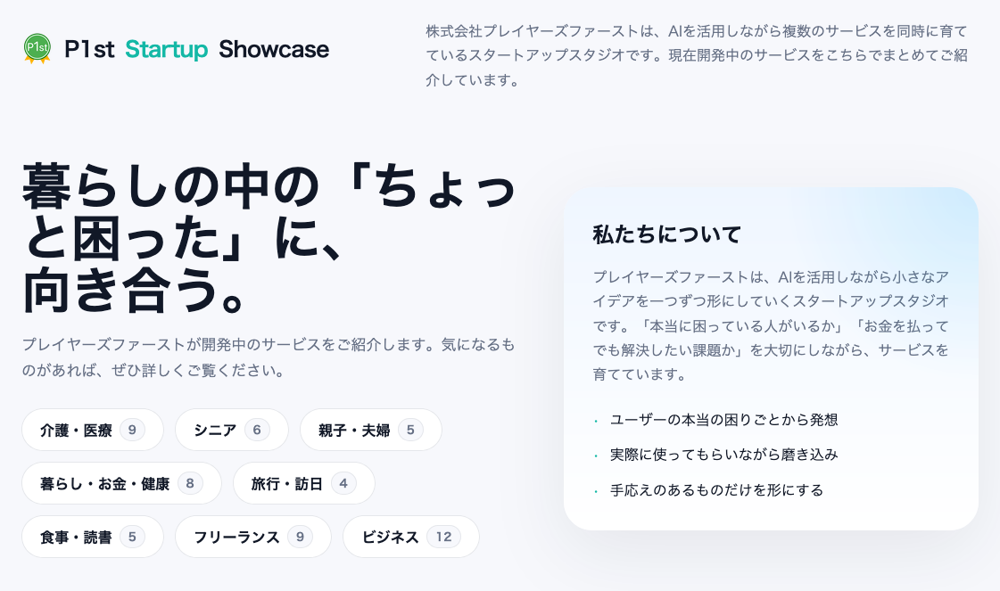

[株式会社プレイヤーズファースト](https://company.p1st.app/)を経営していますが、常に新しい取り組みをしてチャレンジを継続したいと思ってきました。

このたび、[P1st Startup Showcase](https://showcase.p1st.app/?utm_source=personal_blog&utm_medium=owned_media&utm_campaign=p1st_startup_showcase)にて、 **「親の介護おサイフ診断」** と **「次案件ナビ」** という2つの無料簡易診断LPを1日で立て続けに公開しました。

なぜ今、このスピード感でプロダクトを量産しているのか。その裏にある「AI時代のひとりスタートアップの思想」と、極限まで削ぎ落とした技術的アプローチについて書き残しておきます。

---

## 1. なぜ「今」、ひとりスタートアップなのか (発端と直感)

この取り組みの発端は、**「AIの登場により、今までのスタートアップの取り組み方が劇的に変わる」**と確信したことでした。

AIが本格的に台頭する前にも「ひとりスタートアップ」について考え、実践してきました。

実践の経験を通じて獲得したノウハウや考え方は体系化して、 Kindle 本「[ひとりスタートアップ: 無理せず確実に成長するための実践ガイドブック](https://link.amazon/B04rBurql)」にまとめました。

しかし当時は、いかにひとりで効率的に振る舞ったとしても、ひとりでプロダクトを形にし、検証を回すだけでも膨大な時間とリソースが必要でした。

それが **AIと組み合わせることで、ひとりスタートアップのチャレンジは劇的に高速化されました。** アイデアからデザイン、実装、デプロイに至るまで、AIが強力なコ・ワーカー(相棒)として伴走してくれます。

**「まさに、ひとりでスタートアップを成功させるための環境が整った」**

**「この大きなAIの波に乗り遅れたくない。そのメリットを自分のチャレンジに全ベットして活かしたい」**

心の底から**「今しかない」という強い直感**がありました。その衝動のままに始めたのが今回の実験です。

---

## 2. これまでの経験から導いた「削ぎ落とし」の哲学

私自身、これまで数々のアジャイル開発の現場やスタートアップの立ち上げに身を置いてきました。

そこで痛感してきたのは、**「本当にユーザーに価値があるか分からないものに、最初から多くの時間やチームのリソースをかけてしまう難しさ」**です。

世の中の多くのサービスは、作り込む前に力尽きるか、過剰な機能にコストを奪われます。

だからこそ今回の検証では、あえて以下の「割り切り」を徹底しました。
- 決済機能は作らない（ゴールはメールアドレス＝リードの獲得のみ）
- 複雑なバックエンドやDBは排除し、サーバーレスの静的HTML/JSで完結させる
- ユーザー登録なしで「その場で自分の結果（おサイフ寿命や90日プラン）が出る」強烈な体験をフックにする

これまでのアジャイル開発やスタートアップ経験で培った「小さく産んで、最速で仮説検証を回す」という哲学に、最新のAIツール（Claude Code等）を掛け合わせることで、圧倒的なスピード感でのMVP検証が可能になりました。

---

## 3. 検証中のプロダクトについて

今回立ち上げた2つのサービスです。皆様も、もしよろしければ触ってみてください。

### ■ 親の介護おサイフ診断

3つの質問に答えるだけで、在宅・施設別の月額自己負担の目安や、おサイフの寿命をその場で可視化するツールです。

👉 **[親の介護おサイフ診断を試してみる（無料）](https://showcase.p1st.app/osaifu-check/?utm_source=personal_blog&utm_medium=owned_media&utm_campaign=osaifu_personal)**

### ■ 次案件ナビ

フリーランスのエンジニア向けに、契約終了日を入れるだけで「次の案件探しの90日プラン（相場確認やエージェント連絡のスケジュール）」がその場でカレンダー形式で出ます。

👉 **[次案件ナビで90日プランを作ってみる（無料）](https://showcase.p1st.app/tsugianken-navi/?utm_source=personal_blog&utm_medium=owned_media&utm_campaign=tsugi_personal)**

---

## 4. 実装の裏側：Claude Codeと静的HTMLによる爆速プロトタイピング

今回の開発では、インフラに複雑な構成は取っていません。すべてプレーンな静的HTML/CSS/JSで統一し、フォーム送信はFormspreeで完結させています。

例えば「次案件ナビ」では、コードの大部分を共通化し、入力された契約終了日から逆算して実際のカレンダー暦日を動的に描画する「マイルストーン配列エンジン」をClaude Codeにサクッと組んでもらいました。

重厚なシステムを時間をかけて構築する前に、まず手元の静的ファイルとAIの爆速コーディングで「ユーザーにとって本当に価値のある体験」を形にし、GA4のイベント（`generate_lead`）とUTMパラメータで数字の現実を直視する。このループを圧倒的な回転数で回すことが、いま個人でできる最高の事業実験だと感じています。

---

## 5. おわりに：まずは市場に問い続ける

綺麗なプレスリリースや会社ブログでは語りきれない少し生々しい裏側をお伝えしたいと思い書いてきましたが、大事なのはここから数字がどう動くか、そしてユーザーに本当に刺さるかです。

「ひとりスタートアップ」の環境がこれほど整った時代に、個人としてどこまでやれるか。これからも実験と検証のプロセスをオープンにしながら、泥臭くプロダクトを磨き続けていこうと思います。

もし同じように個人開発やAI駆動開発に挑んでいる方がいれば、ぜひ一緒に知見をシェアしていきましょう！
